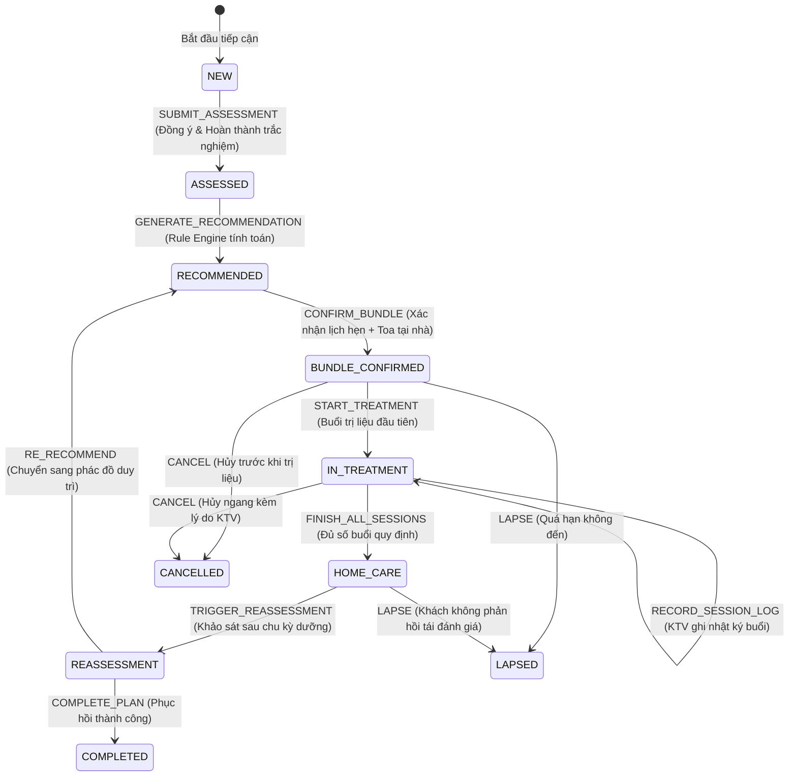
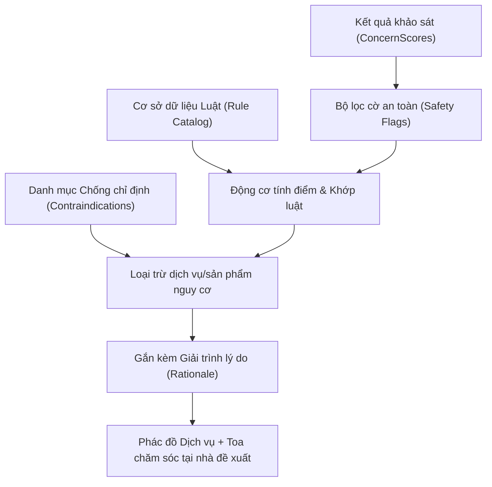
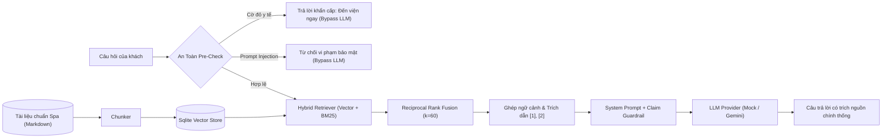

# Kiến Trúc Hệ Thống — Digital Wellness Platform (Spa)

Tài liệu này mô tả chi tiết kiến trúc phần mềm, các quyết định thiết kế kỹ thuật, nguyên tắc bất biến và mô hình luồng dữ liệu của hệ thống **Digital Wellness Platform** (Hệ thống Quản lý Liệu trình & Chăm sóc Cá nhân hóa cho spa).

---

## 1. Triết lý Thiết Kế & Nguyên Tắc Cốt Lõi

Khác biệt hoàn toàn với các nền tảng thương mại điện tử hoặc đặt lịch hẹn đơn thuần:

1. **Không có giỏ hàng, không có danh mục bán lẻ đại trà**: Sản phẩm dưỡng da/thảo dược chỉ xuất hiện dưới dạng "toa chăm sóc tại nhà" gắn liền với phác đồ dịch vụ hoặc do kỹ thuật viên chỉ định.
2. **Khảo sát & Gợi ý tất định (Rule Engine)**: Gợi ý dịch vụ và sản phẩm do hệ thống quy tắc logic (`domain/recommendation`) quyết định 100% tất định, có kiểm tra cờ an toàn/chống chỉ định và giải trình lý do rõ ràng. AI/RAG không được can thiệp đổi kết quả gợi ý.
3. **Vòng đời khách hàng là State Machine tường minh**: Trạng thái phác đồ (`PlanState`) chỉ được chuyển đổi qua hàm chuyển trạng thái thuần túy có guard kiểm tra và lưu vết lịch sử (`PlanStateHistory`).
4. **Trợ lý tư vấn AI RAG an toàn & có trích nguồn**: Sử dụng Hybrid Retrieval (Cosine + BM25 Reciprocal Rank Fusion) tra cứu kiến thức spa chính thống. 100% câu hỏi cờ đỏ y tế khẩn cấp và prompt injection được lọc chặn ngay tại lớp Pre-Check, không gửi PII đến mô hình ngôn ngữ lớn.

---

## 2. Kiến Trúc Phân Tầng Nghiêm Ngặt (Layered Architecture)

Hệ thống tuân thủ nghiêm ngặt mô hình kiến trúc phân tầng một chiều, được bảo vệ bằng quy tắc ESLint `no-restricted-imports`:

```
┌─────────────────────────────────────────────────────────────┐
│                       Presentation Layer                     │
│  Next.js App Router (app/(public), app/(customer), etc.)    │
│  React Server Components + Interactive Client Widgets       │
└──────────────────────────────┬──────────────────────────────┘
                               │ phụ thuộc
                               ▼
┌─────────────────────────────────────────────────────────────┐
│                       Application Layer                      │
│  Use-Cases & Server Actions (Booking, Assessment, Staff)    │
│  Điều phối Use-Case, quản lý giao dịch & phân quyền (RBAC) │
└──────────────────────────────┬──────────────────────────────┘
                               │ phụ thuộc
                               ▼
┌─────────────────────────────────────────────────────────────┐
│                          Domain Layer                        │
│  LÕI THUẦN TÚY (Pure TypeScript):                           │
│  • Recommendation Engine (Rules, Contraindications, Match)   │
│  • Lifecycle State Machine (PlanState, Transition Guards)   │
│  • Quiz Scoring Logic & Safety Flag Extraction              │
│  * KHÔNG import Next.js, React, Prisma, fetch hay Network   │
└─────────────────────────────────────────────────────────────┘
                               ▲ hiện thực interface
                               │
┌──────────────────────────────┴──────────────────────────────┐
│                    Infrastructure Layer                      │
│  Adapters & External Systems:                                │
│  • Prisma ORM / SQLite / PostgreSQL                          │
│  • Auth.js v5 (Credentials, Session, Role Guards)           │
│  • RAG Pipeline (VectorStore, Hash/Gemini Embeddings, LLM)   │
└─────────────────────────────────────────────────────────────┘
```

---

## 3. Máy Trạng Thái Vòng Đời (Lifecycle State Machine)

Vòng đời khách hàng từ khi tiếp cận đến khi hoàn tất phác đồ chăm sóc được mô hình hóa thành một Finite State Machine với các Guard kiểm tra điều kiện chuyển tiếp:



Mỗi lần chuyển trạng thái thành công đều được ghi lại vào bảng `PlanStateHistory` gồm: `fromState`, `toState`, `event`, `reason`, `actorId` và dấu thời gian UTC.

---

## 4. Động Cơ Gợi Ý Tất Định (Deterministic Recommendation Engine)



- **Tính tất định (Determinism)**: Cùng một tập điểm triệu chứng và cờ an toàn luôn sinh ra cùng một danh sách phác đồ với thứ tự ưu tiên giống hệt nhau.
- **Xử lý chống chỉ định (Contraindications)**: Nếu khách hàng có cờ mang thai (`pregnant`), dị ứng tinh dầu (`allergy-essential-oil`) hoặc sốt/ốm cấp tính (`fever-acute-illness`), các dịch vụ hoặc sản phẩm chứa thành phần xung đột sẽ tự động bị loại khỏi danh sách gợi ý hoặc gắn nhãn cảnh báo `requiresStaffReview: true`.

---

## 5. Hạ Tầng RAG & Trợ Lý Tư Vấn AI



### Đặc tính nổi bật của RAG:

1. **Lớp kiểm tra an toàn (Pre-Check)**:
   - Phát hiện các dấu hiệu y tế cấp tính (đau tim dữ dội, ngất xỉu, khó thở cấp, nhiễm trùng nặng, co giật) và trả lời theo mẫu chỉ định y khoa chuẩn mà **không gọi LLM**.
   - Phát hiện kỹ thuật Prompt Injection / Jailbreak và từ chối xử lý an toàn.
2. **Quyền riêng tư dữ liệu (Zero PII to AI)**:
   - Tên, email, số điện thoại của người dùng tuyệt đối không được chuyển đến LLM hay dịch vụ Vector.
3. **Trích dẫn nguồn nghiêm ngặt**:
   - Mọi câu trả lời của trợ lý bắt buộc kèm theo chỉ mục tài liệu trích dẫn `[1]`, `[2]` trỏ về các bài kiến thức đã được kiểm chứng.

---

## 6. Mô Hình Bảo Mật & Quyền Riêng Tư (Security & Privacy)

- **Phân quyền vai trò (Role-Based Access Control)**:
  - `CUSTOMER`: Chỉ được xem và thao tác trên lịch hẹn, phác đồ và dữ liệu trắc nghiệm của chính mình (kiểm tra server-side ở từng Use-Case).
  - `THERAPIST`: Chỉ xem và ghi nhận nhật ký trị liệu cho các khách hàng được phân công.
  - `ADMIN`: Quản trị danh mục dịch vụ, sản phẩm, quy tắc gợi ý và giám sát hệ thống; không được tùy tiện đọc chi tiết nhật ký trị liệu nhạy cảm nếu không có thẩm quyền.
- **Quyền riêng tư chuẩn GDPR**:
  - Khách hàng có thể xuất toàn bộ dữ liệu lịch sử của mình ra file JSON (`/tai-khoan`).
  - Khách hàng có quyền yêu cầu xóa vĩnh viễn tài khoản và toàn bộ dữ liệu sức khỏe (Right to Erasure) với hộp thoại xác nhận bảo vệ hai lớp.
- **Kiểm soát truy cập & Audit Log**:
  - Ghi nhận `AuditLog` cho mọi sự kiện nhạy cảm: Đăng nhập, Thay đổi vai trò, Chỉ định toa, Xóa dữ liệu khách hàng.
  - Giới hạn tần suất (Sliding Window Rate Limiter) trên các route nhạy cảm: Đăng nhập (`/api/auth`), Đăng ký, Trợ lý AI (`/api/assistant`).
  - Quét secret tự động trước mỗi commit bằng **Gitleaks**.
